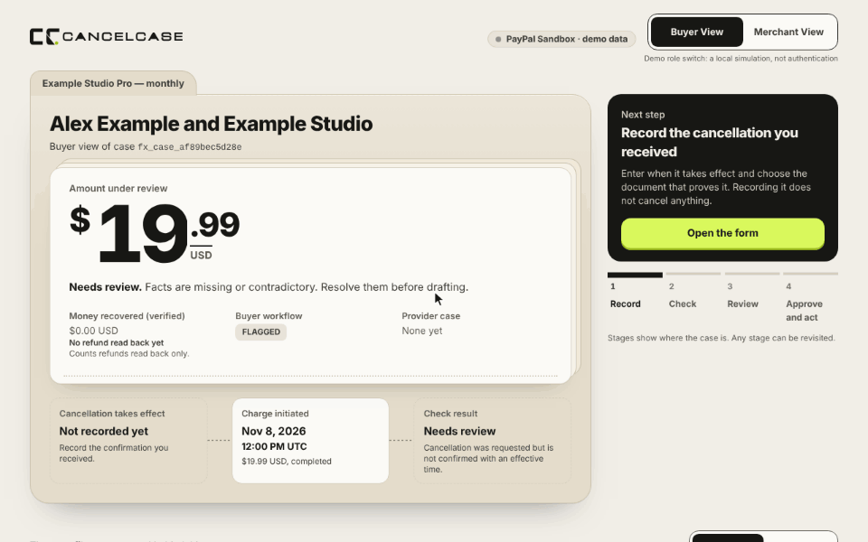
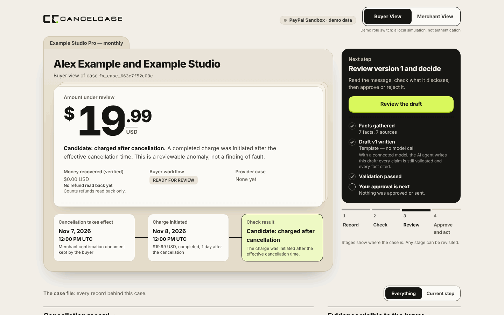
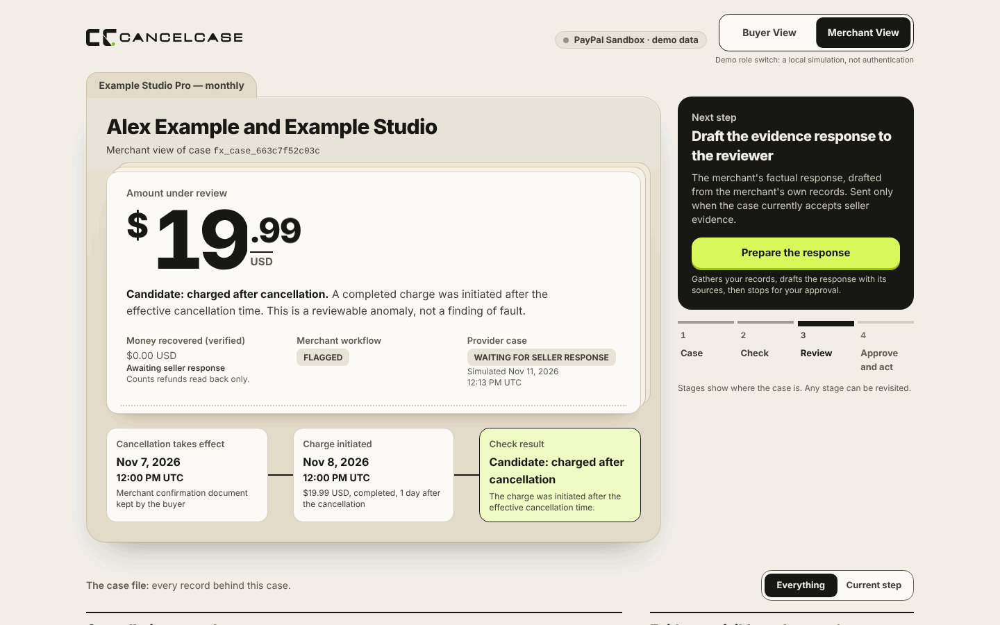
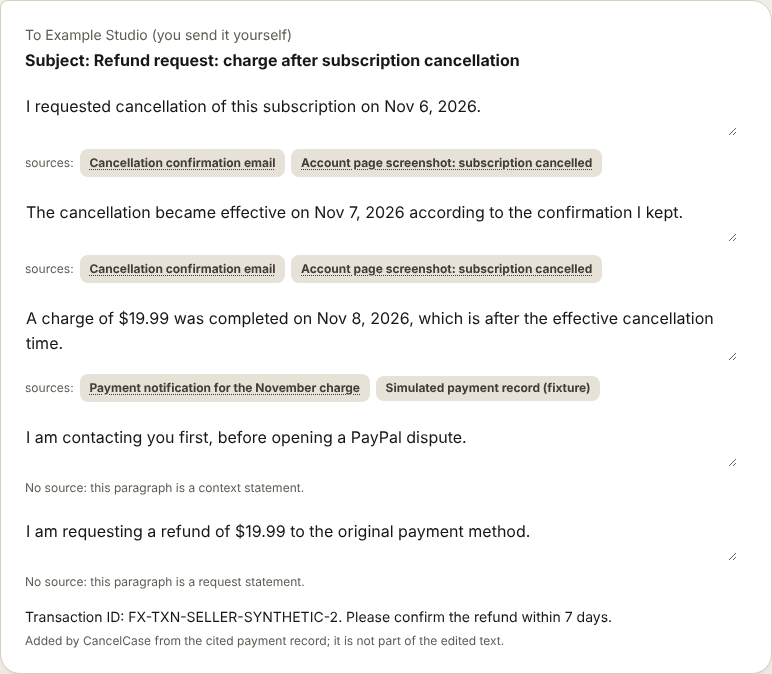
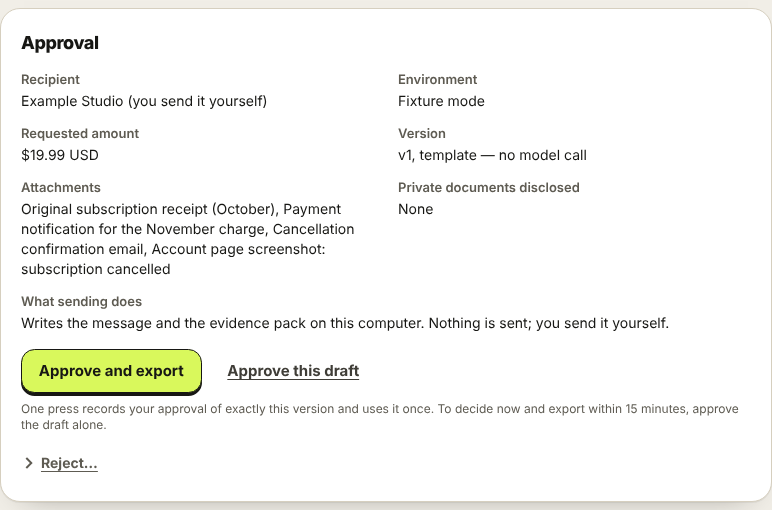
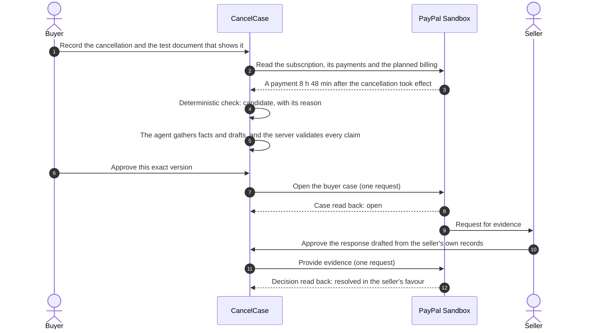
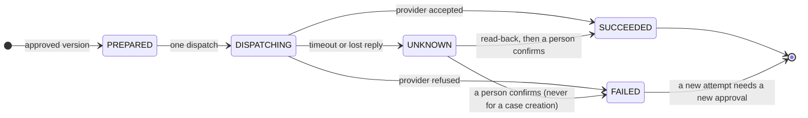
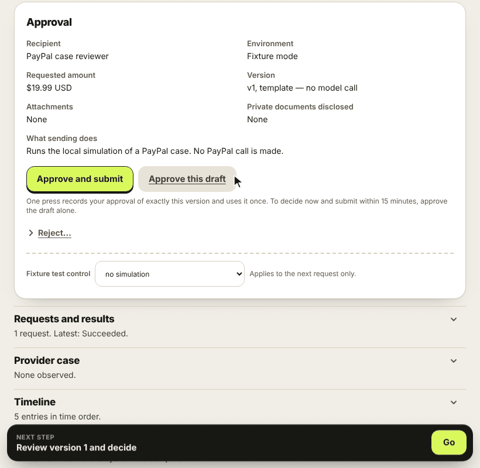
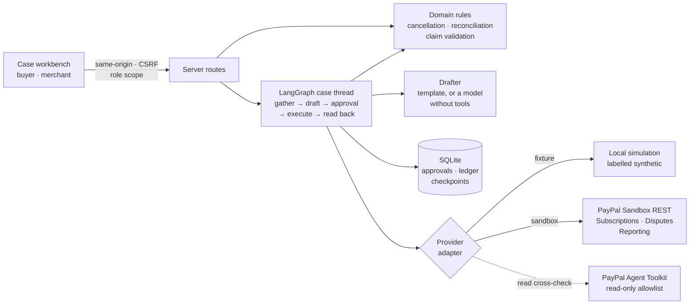
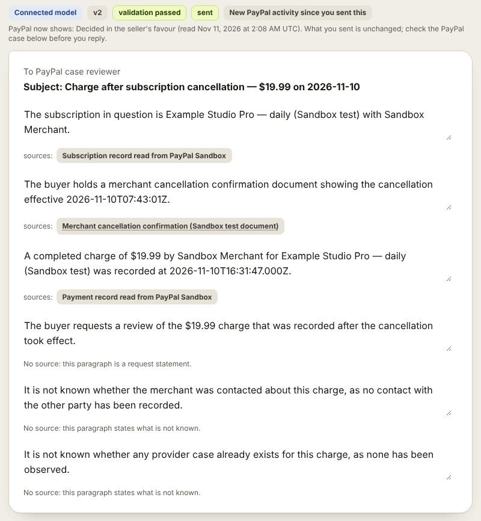

<p align="center">
  <picture>
    <source media="(prefers-color-scheme: dark)" srcset="docs/assets/logo-horizontal-white.svg">
    
  </picture>
</p>

<p align="center"><strong>The buyer's side of a PayPal dispute</strong><br>
<em>Cancelled, still charged? An AI agent proves it, files it and tracks it.</em></p>

<p align="center">
  <a href="https://github.com/aiyufan3/cancelcase/actions/workflows/ci.yml"></a>
  
  
  
  
</p>

<p align="center">
  <a href="#quick-start">Quick start</a> ·
  <a href="#how-it-works">How it works</a> ·
  <a href="#ai-what-the-model-does-and-what-it-does-not">AI agent</a> ·
  <a href="#architecture">Architecture</a> ·
  <a href="#paypal-integration">PayPal integration</a> ·
  <a href="JUDGES.md">Reviewer guide</a>
</p>

<p align="center"><a href="https://www.youtube.com/watch?v=emmhZLkXz9g"><strong>Watch the demo video</strong></a></p>

You cancelled a subscription. The confirmation says access ends on the 7th. On the 8th you are charged anyway.

Most dispute tooling is built for sellers. **CancelCase is for the person who was charged.** It does five things:

1. Records when you cancelled, and the documents that show it.
2. Flags a charge that came after.
3. Drafts the case, with every statement of fact cited.
4. Sends only the exact version you approved.
5. Reads PayPal's answer back and shows only what was observed.

**An AI agent does the work between your decisions.** A LangGraph agent gathers the facts from PayPal and your documents, a language model drafts the case as cited claims, and the server validates every claim. A person approves; the agent then submits once and reads PayPal back. The offline demo below uses a labelled template in place of the model. [How the AI works](#ai-what-the-model-does-and-what-it-does-not).

<p align="center">
  
  <br><sub>Offline fixture with synthetic data. Record the cancellation; one press then prepares the case and stops for your approval.</sub>
</p>

## Who it's for

- **The person charged after cancelling.** They hold the proof, such as a confirmation email or an account screenshot, but have to turn it into a dated, consistent case on their own.
- **Why seller tools do not help.** Most dispute tooling is built for sellers answering chargebacks. It does not help a buyer assemble evidence or word a claim.
- **What CancelCase changes.** Rules check the charge against the cancellation time, the agent drafts the case with every fact cited, and nothing is filed until the person approves the exact version. PayPal's answer is read back.
- **Beyond Sandbox (planned).** This prototype runs on PayPal Sandbox. A planned production version would prepare an evidence pack for the buyer to submit in PayPal, because PayPal offers buyer case creation through its API in Sandbox only. Live account access and read-back are not implemented here.
- **How common it is.** The FTC received nearly 70 complaints a day about subscription and recurring-charge practices in 2024, up from 42 a day in 2021 ([FTC, 16 October 2024](https://www.ftc.gov/news-events/news/press-releases/2024/10/federal-trade-commission-announces-final-click-cancel-rule-making-it-easier-consumers-end-recurring)).

## Highlights

- **Run end to end on PayPal Sandbox.** From a payment after a recorded cancellation to PayPal's decision on the case, every step was read back. On the next payment, a refund issued by the seller was read back as well. Each call is listed in [docs/sandbox-evidence.md](docs/sandbox-evidence.md).
- **An agent with a ledger.** One press reads and drafts, then stops. A person approves the exact version; each request is sent once; an uncertain result is never resent.
- **Rules decide facts.** A deterministic check compares the charge with the effective cancellation time and names every reason. A model only drafts text.
- **Every statement of fact is cited.** Before anything can be approved, the server rejects invented sources, amounts and dates that do not match the cited facts, and promises about outcomes, in the subject as well as in the text.
- **Both sides, private by role.** Buyer and seller work on the same case. A private document never reaches the other side, a model or a recipient unless its owner includes it.
- **Runs offline in two commands.** No account, no key, no network.

Recovery is never guaranteed. CancelCase does not cancel subscriptions and does not decide disputes: the merchant or PayPal decides.

## Quick start

You need Node.js 22.12+ (or 24+) and pnpm 10.

```sh
pnpm install
pnpm demo
```

`pnpm demo` seeds one synthetic case (Alex Example and Example Studio, USD 19.99) and serves it at `http://127.0.0.1:3000`. Everything is local: the header says *PayPal Sandbox · demo data*, and each record is labelled *synthetic fixture*. No PayPal call and no model call is made.

To start over at any point, even with a simulated request still marked `UNKNOWN`, run `pnpm demo:reset --yes --acknowledge-unresolved`, then `pnpm demo`.

If you are reviewing the project, [JUDGES.md](JUDGES.md) is a short guided path. It includes a read-only check against your own Sandbox app.

### The guided path

The page always shows one **next step**. When that step is a read or a draft, its button does it and keeps going until a person is needed. Recording facts, approving and sending stay yours.

1. **Open the form** and fill it from the fixture confirmation email. The check turns into *Candidate: charged after cancellation* and names its reason.
2. **Prepare my case.** One press gathers the facts, drafts the request and validates it. Each paragraph lists the documents it rests on.
3. **Approve and export.** The approval sheet states the recipient, the version, the attachments and what sending does. One press approves exactly that version and uses the approval once. The result then lists the approved message, the evidence pack and the attachments you selected, each as a download.
4. **Escalate to PayPal.**
   - Choose the PayPal channel, give a reason, and press **Prepare my case** again.
   - Set the fixture control to *simulate ambiguous timeout* and press **Approve and submit**. The control applies to that one request.
   - The request becomes `UNKNOWN`. A read-back and a person settle it.
5. **Switch to the merchant view.** The buyer's private note is gone, and the seller answers from its own records.

From opening the case to an exported request is five presses. The five steps run as browser tests in [`tests/e2e/main-path.spec.ts`](tests/e2e/main-path.spec.ts), which also downloads the approved files and checks them. [`tests/e2e/fixture-story.spec.ts`](tests/e2e/fixture-story.spec.ts) reaches the same actions through the step-by-step controls and adds a blocked submission, a rejection, keyboard use and a small screen.

| Buyer view after one press | Merchant view of the same case |
| --- | --- |
|  |  |
| **A draft with its sources** | **The approval sheet** |
|  |  |

## How it works

This diagram shows a real run on PayPal Sandbox, as it happened on 2026-11-10 and 2026-11-11:



- PayPal refused the first buyer request because of the format of the cancellation date. It is recorded as failed and was not resent. The corrected request, approved again, opened the case.
- The cancellation was recorded from a clearly labelled Sandbox test document. The PayPal subscription itself was still active, and CancelCase did not cancel it.
- PayPal then decided the case itself, for the seller, so no refund was issued and nothing was recovered. CancelCase read that decision back and shows it as it is: money counts as recovered only when a refund is read from PayPal, never a hoped-for result. The run shows accurate tracking of an unfavourable outcome, not a recovery rate.
- The subscription billed again the next day. For that payment no case was opened at PayPal: the maintainer, acting as the Sandbox seller, refunded it in PayPal's Sandbox pages, and the next read from the app showed the payment as refunded and counted $19.99 as recovered, only then. This shows the read-back of a refund on test accounts, not a recovery the product obtained.
- Times, endpoints and results for every call are in [docs/sandbox-evidence.md](docs/sandbox-evidence.md).

### Every write is sent once

An approval is bound to six things: the action, the role, the environment, the payload hash, the evidence snapshot and the attachment hashes. It expires after 15 minutes, and any edit voids it.

Each export or submission is a durable operation:



<p align="center">
  
  <br><sub>Offline fixture: a timeout becomes <code>UNKNOWN</code>. The read-back finds the case, and a person records the decision.</sub>
</p>

## Architecture



| Path | What lives there |
| --- | --- |
| `src/domain` | Pure, tested rules: cancellation state, reconciliation, approvals, claim validation, provider state |
| `src/graph` | The LangGraph case thread, with a human pause before every write |
| `src/llm` | Drafters: a deterministic template, and a live model adapter that receives data only |
| `src/paypal` | Provider adapters: the fixture simulation, the Sandbox REST client and the read-only Agent Toolkit |
| `src/server` | Configuration, persistence, the operation ledger, services and HTTP guards |
| `src/app`, `src/components` | Next.js routes and the case workbench |
| `scripts` | `demo`, `sandbox:check`, `sandbox:setup`, `llm:check` and the security tooling |
| `tests` | Unit, integration and browser tests |

More detail is in [docs/architecture.md](docs/architecture.md).

## PayPal integration

Connected mode talks to **PayPal Sandbox only**; a live origin is refused at startup. A capability counts as verified only after it was exercised against Sandbox with the operator's own credentials and read back. Fixture results never count as PayPal results.

| Area | What CancelCase does | Sandbox status |
| --- | --- | --- |
| Subscriptions and Catalog | Creates a product, a plan and a subscription as three recorded writes; the buyer approves in the browser; payments and the next planned billing are read back | Verified |
| Disputes, buyer side | Opens a case with the buyer's consent (*Log in with PayPal*) and `PayPal-Auth-Assertion` | Verified on a real payment. PayPal offers this endpoint in Sandbox only |
| Disputes, seller side | Reads the case with validated action links; provides evidence as one multipart request after a fresh read | Verified three times, once with a PDF and a PNG attached |
| Disputes, decision | Reads PayPal's decision back and reports it as read | Verified: `RESOLVED_SELLER_FAVOUR`, with no test control used |
| Payments, refund read-back | Reads each payment's status with the subscription's transactions; a refund counts as recovered only after it is read | Verified once (2026-11-12): a refund the maintainer issued as the Sandbox seller, in PayPal's own pages, was read back |
| Sandbox test controls | `require-evidence` and `adjudicate` (settlement), labelled as simulations | `require-evidence` verified; `adjudicate` implemented, not sent |
| Reporting | Transaction Search read | Verified |
| PayPal Agent Toolkit | Allows eight read tools and nothing else; each dispute read is cross-checked against REST | Verified |
| Refunds, accepting claims, payments | Never available to the agent | Deliberately disabled |
| Webhooks | None | Not built |

The full record is in [docs/testing-and-demo.md](docs/testing-and-demo.md#4-status-of-verification-in-this-repository). Every call of the end-to-end run is in [docs/sandbox-evidence.md](docs/sandbox-evidence.md).

## AI: what the model does, and what it does not

<p align="center">
  
  <br><sub>PayPal Sandbox, recorded run on 2026-11-10: a draft written by the connected model; every statement of fact cites a source, and the draft passed server validation.</sub>
</p>

- **An agentic workflow runs the case.** A LangGraph thread gathers the facts, drafts, pauses for a person, executes the approved action and reads the result back. It is checkpointed on disk, so a restart resumes at the pause and a replay repeats no write.
- **A language model drafts; it decides nothing.** It receives only the facts the current role may see and can cite. It has no tools, and it must return structured claims that the server validates. Drafts are labelled *Template — no model call*, *Connected model* or *Human edit*.
- **Rules decide facts.** Reconciliation, approval binding, dispatch and recovery are ordinary tested code. Text inside an uploaded document is data and never becomes an instruction.
- **The toolkit is read-only.** The agent can list and read; it cannot refund, concede or pay.

### Why not just a chatbot?

| A chatbot's letter | CancelCase |
| --- | --- |
| Free text; nothing says where a statement comes from | Every statement of fact cites a source, and the server checks the citation |
| A wrong amount or date goes out unnoticed | An amount, date, time or transaction ID in the subject or the text blocks approval when it does not match the cited facts, or is written in a form the check does not read (another currency, a numeric date, a time zone other than UTC) |
| Whatever was pasted is what gets sent | One approval is bound to the exact content, is used once and is voided by any edit |
| The conversation ends when the letter is written | After each submission the agent reads PayPal back; an uncertain result stays `UNKNOWN` and is never resent |

**The agent cannot call PayPal write tools, by design.** Its toolkit is read-only and the model holds no tools. A write happens only after a person approves the exact version, and the operation ledger sends it once. In agentic commerce, that is the safety line.

### Built with AI

**In the app**

- **Model:** a language model reached through a vendor-neutral adapter. It drafts the letter as structured claims for the server to validate, and it holds no tools.
  - `LLM_PROVIDER` picks the request format: Anthropic Messages or OpenAI-compatible Chat Completions. The format says how a request is written, not which service answers it.
  - The service, endpoint and model come from your `.env`. There is no default.
- **Agent stack:**
  - [LangGraph](https://www.npmjs.com/package/@langchain/langgraph): orchestration, checkpoints and the human-in-the-loop interrupt;
  - [`@paypal/agent-toolkit`](https://www.npmjs.com/package/@paypal/agent-toolkit): read-only PayPal tools;
  - [LangSmith](https://www.npmjs.com/package/langsmith): optional, redacted tracing ([docs/observability.md](docs/observability.md)).

**Used to build it (not part of the app)**

- Claude Cowork (Anthropic) and Codex CLI (OpenAI), under human direction, for implementation, review and test writing. Every change passes the same automated gates as any other contribution.

## Connected Sandbox mode

Connected mode is opt-in and needs your own PayPal Developer account.

1. Create a Sandbox REST app. Copy `.env.example` to `.env`, fill `PAYPAL_CLIENT_ID` and `PAYPAL_CLIENT_SECRET`, and keep `PAYPAL_ENV=sandbox`.
2. Run `pnpm sandbox:check`. It is a read-only diagnostic that reports each capability as `VERIFIED`, `BLOCKED` or `NOT_TESTED`.
3. Run `pnpm sandbox:setup --preview`, then `--confirm`. This creates a synthetic product, plan and subscription as three recorded writes.
   - Approve the subscription in a browser with a Sandbox Personal account.
   - Then run `pnpm sandbox:setup --resume`. It reads the subscription back and builds the connected case.
4. Run `pnpm demo:sandbox`. It serves the same UI on Sandbox data. Every provider write still needs an approval in the UI.

**Optional model drafting.** Set these variables, then run `pnpm llm:check`:

- `LLM_ENABLED=true`
- `LLM_PROVIDER`: the wire protocol, either `anthropic` (Messages) or `openai` (Chat Completions)
- `LLM_BASE_URL`
- `LLM_MODEL`
- `LLM_API_KEY`

There is no default host. Configured model settings stay out of the UI, the exports and the server log. Ignored local diagnostics under the data directory may include model and endpoint metadata.

The full procedure is in [docs/testing-and-demo.md](docs/testing-and-demo.md#3-connected-verification-your-sandbox-credentials). It covers uncertain setup stages, a delayed first billing, buyer consent, importing a case and the Sandbox test controls.

## Observability (optional)

Set `LANGSMITH_TRACING=true` and `LANGSMITH_API_KEY` to send a trace of each agent run to LangSmith. Each trace has one span per graph node (`gather`, `draft`, `review`, `execute`, `readback`) and is tagged with the case ID and the mode.

- Tracing is off by default, and nothing is sent without the key.
- Runs are redacted before they leave your machine.
- The traced thread state has no field for drafts, evidence, PayPal payloads, prompts or credentials. That describes the implementation and what its tests and the recorded fixture runs checked, not a guarantee about every future value.

[docs/observability.md](docs/observability.md) lists exactly what is sent.

## Development

| Command | Purpose | Safety behaviour |
| --- | --- | --- |
| `pnpm demo` | Seed the fixture and serve it on 127.0.0.1 | No secrets, no network; idempotent seed |
| `pnpm demo:reset` | Delete the fixture data | Asks for confirmation (or `--yes`); refuses Sandbox data and `.env`; refuses unresolved operations unless `--acknowledge-unresolved` |
| `pnpm demo:sandbox` | Serve connected mode | Fails closed on non-Sandbox origins or missing variables; never auto-dispatches |
| `pnpm sandbox:check` | Read-only capability diagnostic | Creates nothing |
| `pnpm sandbox:setup` | Recorded Sandbox setup, resume, recovery, import and test controls | One approved, recorded request per write; unknown results stop until recovered |
| `pnpm llm:check` | Model configuration check, or one drafting run on synthetic facts | Reports presence and shape without printing values |
| `pnpm lint` · `pnpm typecheck` · `pnpm test` · `pnpm build` | Quality gates | No credentials needed |
| `pnpm test:e2e` | Browser tests; run `pnpm exec playwright install chromium` once first | Fixture mode, isolated data |
| `pnpm security:staged` | Private-path, content and secret scan, installed as a pre-commit hook | Fails closed when the scanner is missing |
| `pnpm deps:audit` | Production dependency audit | Fails on an unreviewed advisory or an incomplete report (see [SECURITY.md](SECURITY.md)) |

CI runs every gate on Node 22 and Node 24, without credentials or provider calls. The acceptance cases are listed in [docs/testing-and-demo.md](docs/testing-and-demo.md).

## Limitations

- One story is handled end to end: a USD subscription charge after a confirmed cancellation. Other currencies, multi-charge discovery and arrears accounting go to review instead of being guessed.
- Only the PayPal channel has a connected adapter. Merchant refund requests, app-store refunds and card chargebacks are exports you send yourself.
- The role switch is a local demonstration convenience, not authentication. The server binds to loopback and is not designed for hosting.
- PayPal offers buyer case creation through the API in Sandbox only, and it needs the create scope and the buyer's consent. This prototype runs on Sandbox only; live account access and read-back are not implemented. In a planned production version the buyer would file the case in PayPal, using the text and documents CancelCase prepares.
- The draft check reads a limited set of written forms (US dollar amounts, ISO dates and dates with a month name, UTC times). An amount or date in a form it cannot read blocks approval; a bare number is not checked. It does not verify that a paraphrase follows from its source.
- A case creation whose result is unknown is never recorded as failed, because no read-back proves that PayPal created no case. It keeps its claim on the charge until the case is found, and this version offers no override.
- Recovery of an unknown result covers the three case actions. The case recovery steps refuse an unknown Sandbox setup or test-control request without changing it. A setup stage is recorded with `pnpm sandbox:setup --recover`; an unknown test-control request has no recovery step in this version and blocks another attempt on that case.
- Downloads of an approved export are served only when the stored files still match the hashes recorded at approval. An export made before those records existed is listed as not available.
- After a payment is fully refunded, the case is classified *No anomaly* and its summary says the facts do not show a charge after cancellation. The reason line (*The charge has been fully refunded*) and the refund figure say what happened; the summary sentence is imprecise for this situation.
- Submitting evidence or a case never implies an outcome. A `RESOLVED` state comes only from PayPal.
- Hashes prove that a file's bytes did not change, not that its content is true. Human review is part of the design.

## Data and privacy

All data lives under `data/local/<mode>/` on your machine:

- a SQLite database;
- a second SQLite file with workflow checkpoints;
- evidence files and exports.

Only these leave your machine:

- the approved request you submit to PayPal Sandbox;
- when model drafting is enabled, the role-filtered facts sent to the configured model;
- when LangSmith tracing is on, the redacted agent runs ([docs/observability.md](docs/observability.md)).

**Delete case** in the UI removes the case with its evidence, drafts, approvals, operations and checkpoints. `pnpm demo:reset` removes the fixture directory. Deletion does not recall anything already sent to a provider, and filesystem deletion is not secure erasure.

## Roadmap

- **Next:**
  - verified webhooks for case updates;
  - CSV charge import;
  - reminders before a planned billing;
  - PayPal MCP integration.
- **Later:**
  - inbox and bank-data connectors;
  - app-store channels;
  - real user accounts and a hosted, multi-tenant deployment.

## Contributing and security

See [CONTRIBUTING.md](CONTRIBUTING.md), the [Code of Conduct](CODE_OF_CONDUCT.md) and the [security policy](SECURITY.md). Notable changes are listed in [CHANGELOG.md](CHANGELOG.md).

## License and trademarks

Apache-2.0. See [LICENSE](LICENSE). Dependencies keep their own licenses; `@paypal/agent-toolkit` is published under its own terms on npm.

PayPal is a trademark of PayPal, Inc. CancelCase is an independent open-source project. It is not affiliated with, sponsored by or endorsed by PayPal, and it uses the PayPal name only to describe the Sandbox APIs it integrates with.

The CancelCase wordmark is set in Michroma, used under the SIL Open Font License 1.1.
